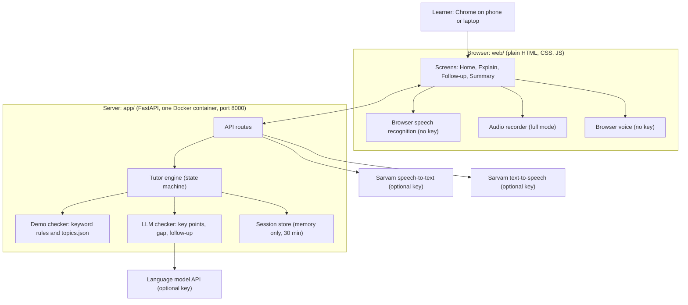
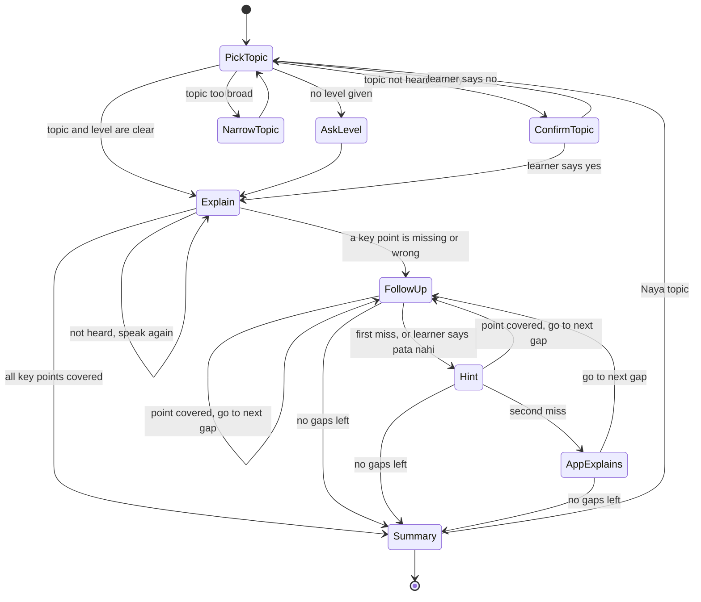

# Samjhao: handover for Claude Code

**Project:** Samjhao, a voice tutor that listens
**Owner:** Shubham Singh (solo entry, Builder #1621)
**Event:** Build for Bharat (India Runs on Voice), a Scaler × Wispr Flow hackathon, Round 2
**Written:** Fri 27 Nov 2026
**Hard deadline:** Mon 30 Nov 2026, 11:59 pm IST. One submission only. Everything must stay public and working until 2 Dec 2026.

Read this whole file before writing any code. Section 1 is plain English. The sections after it get steadily more technical.

---

## 1. The idea in plain English

### What Samjhao is

"Samjhao" is Hindi for "explain it to me".

Most learning apps talk and the student listens. Samjhao does the opposite. The student talks, and the app listens.

1. A learner says a topic, for example "Newton's third law, Class 11".
2. Samjhao says: "Explain this to me like I am your younger brother."
3. The learner explains it aloud for about a minute, in Hindi, English, or a mix of both.
4. Samjhao finds the exact place where the explanation breaks, or where a step was skipped.
5. It asks one short question about that place. It does not give the answer.
6. The learner tries again. If they are stuck, they get one small hint. If they are still stuck, Samjhao explains that one point in two sentences and moves on.
7. At the end, the learner sees which points they explained on their own and which ones needed help.

### The problem it solves

Students memorise answers without understanding them, and nobody notices until the exam. A written test shows only the final answer, not the thinking. The fastest way to check understanding is to ask someone to explain the idea in their own words. A teacher with a full classroom cannot do that for every student, and many parents cannot help with the subject or with the English.

### Who it is for

- **Main users:** Class 8 to 12 and college students in small towns and cities in India. They speak Hindi or another Indian language at home and study from English textbooks.
- **Also:** any adult who wants to check whether they really understand something.
- **Any subject, any concept.** This is a deliberate decision by Shubham. Do not narrow the product to school science.

### Why it must be voice

Explaining aloud is the task itself. Typing would defeat it: students type slowly, typing Hindi on a phone is hard, and typed answers get copied from the book. A spoken explanation shows the skipped steps and half-understood words. Learners also think in their home language and switch to English for technical words, and speaking lets them do that freely.

### What we are building this weekend

Not the full product. The Round 2 brief asks for **one core flow that works end to end**. Our one flow is:

> say a topic → explain it aloud → hear one follow-up question about the gap → answer → see the summary

It runs in two modes:

- **Demo mode (no keys needed):** five ready topics, checked by simple rules. This exists because the reviewers start our code with no secret keys, and the app must still work for them.
- **Full mode (keys added):** any topic, checked by a language model, with better Indian-language speech.

---

## 2. The rules we must meet (Round 2)

These come from the official Round 2 brief. Breaking any item in 2.1 means the build cannot move ahead.

### 2.1 Hard gates

| Rule | What it means for us |
|---|---|
| Public GitHub repo | Create a new public repo. All code is written between 27 and 30 Nov. |
| `docker-compose.yml` in the repo | `docker compose up` must start the app with one command. |
| Starts with **no secret keys** | The main screen must appear with no keys set. A feature that needs a key shows a "key not set" message. Reviewers do not add keys. |
| About 300+ lines of our own code | Not a starter template with small changes. |
| One submission only | "Save draft" exists, but "Submit build" is final. |
| Links stay working until 2 Dec | Repo, video and live link must not change or break after submitting. |

### 2.2 What gets submitted

1. **Code on GitHub** (required)
2. **YouTube demo** (required): public or unlisted, 3 minutes or less, showing the product working
3. **Pitch deck PDF** (required): up to 10 MB. The reviewers read the **words**, not the pictures. It must cover: problem and solution; who it is for and how many; what it depends on and the risks; launch plan
4. **Live link** (optional): a small bonus if it works. We host it ourselves.

### 2.3 Form values

- This build is: **An extension of my Round 1 idea**
- Project name: **Samjhao**
- Theme: **Inclusive education**
- State: ask Shubham

### 2.4 What the reviewers value

No scoring rubric is published. The best signal is the brief's own four steps:

1. The problem is real and frequent, and voice makes it better.
2. People finish the main flow by speaking.
3. A working prototype for **one narrow use case**.
4. A few real users finish the task **unaided**.

Round 1 counts for 10% of the Round 2 score. Prizes go by total score.

---

## 3. Architecture

### 3.1 In plain words

There are three layers.

1. **The browser** is what the learner sees and talks to. It shows the screens, listens through the microphone, and speaks the replies.
2. **Our server** holds the rules of the conversation: what to ask next, when to give a hint, when to move on. It is one small program in one Docker container.
3. **Outside services** are optional helpers that need keys: better speech-to-text, a language model to judge explanations, and better text-to-speech.

With no keys, layers 1 and 2 still give a complete working flow on five ready topics. With keys, layer 3 switches on and the same flow works for any topic.

### 3.2 Diagram (plain text, readable anywhere)

```
                 LEARNER  (Chrome on an Android phone or a laptop)
                                    |
                      speaks / listens / taps one mic button
                                    v
+--------------------------------------------------------------------------+
|  BROWSER      web/  (plain HTML + CSS + JS, mobile-first, no build step) |
|                                                                          |
|  Screens:    Home -> Explain -> Follow-up loop -> Summary                |
|                                                                          |
|  Speech in:  (a) browser speech recognition          [no key]            |
|              (b) record audio -> send to server      [full mode]         |
|                                                                          |
|  Speech out: (a) browser voice (speechSynthesis)     [no key]            |
|              (b) play audio sent by the server       [full mode]         |
+--------------------------------------------------------------------------+
                                    |
                        HTTPS, JSON (+ audio in full mode)
                                    v
+--------------------------------------------------------------------------+
|  SERVER       app/  (Python FastAPI, ONE Docker container, port 8000)    |
|                                                                          |
|  /api/config       which mode is on (never returns a key)                |
|  /api/topics       the five demo topics                                  |
|  /api/session/...  start, turn, summary                                  |
|  /api/transcribe   audio -> text            [full mode only]             |
|  /api/speak        text -> audio            [full mode only]             |
|                                                                          |
|            TUTOR ENGINE  (state machine: the rules of the talk)          |
|                 |                              |                         |
|                 v                              v                         |
|          DEMO CHECKER                     LLM CHECKER                    |
|          keyword rules over               writes key points, finds       |
|          data/topics.json                 the gap, writes the            |
|          [no key]                         follow-up question [key]       |
|                                                                          |
|  SESSION STORE: in memory only, deleted after 30 minutes. No database.   |
+--------------------------------------------------------------------------+
          |                         |                          |
          v                         v                          v
  Sarvam speech-to-text     Language model API        Sarvam text-to-speech
  [optional, key]           [optional, key]           [optional, key]
```

### 3.3 Same diagram in Mermaid (renders on GitHub)



### 3.4 The two modes

| | Demo mode | Full mode |
|---|---|---|
| When | No LLM key set | `LLM_API_KEY` set |
| Topics | Five ready topics | Any topic the learner says |
| Who judges the explanation | Keyword rules (`demo_checker`) | Language model (`llm_checker`) |
| Speech in | Browser speech recognition | Sarvam if `SARVAM_API_KEY` is set, else browser |
| Speech out | Browser voice | Sarvam if `SARVAM_API_KEY` is set, else browser |
| Home screen banner | "Demo mode: no API key is set, so 5 ready topics are available. Add a key to explain any topic." | None |

Speech and judging switch on separately. An LLM key alone gives any-topic judging with browser speech. A Sarvam key alone gives better speech on the five demo topics.

### 3.5 One turn, step by step (full mode)

```
Learner taps mic and speaks
  -> browser records audio
  -> POST /api/transcribe  -> server -> Sarvam speech-to-text -> transcript
  -> browser shows transcript with the "Galat suna? Phir se bolo" button
  -> POST /api/session/{id}/turn  {transcript}
       -> tutor engine -> LLM checker -> language model
       <- which points are covered, the first gap, the follow-up question
  <- {action, text, progress}
  -> POST /api/speak {text} -> server -> Sarvam text-to-speech -> audio
  -> browser plays the audio and shows the same text in large type
```

In demo mode the two speech calls happen inside the browser, and the engine calls the demo checker instead of the language model.

### 3.6 The conversation as a state machine



`AskLevel`, `NarrowTopic` and `ConfirmTopic` exist only in full mode. In demo mode the learner picks one of five cards, so the topic and level are already known.

---

## 4. Technology choices

These are recommendations made for speed and for a low risk of Docker failure. Change one only if there is a clear reason, and tell Shubham in plain words first.

| Part | Choice | Why |
|---|---|---|
| Server | Python 3.12 + FastAPI + Uvicorn | Small, quick to write, easy to test |
| Frontend | Plain HTML, CSS and JavaScript, served by the same server | No build step, so nothing extra can break when reviewers run Docker |
| Containers | One service in `docker-compose.yml` | One command, one port (8000) |
| Storage | In-memory Python dict with a 30-minute expiry | The product promises "no login, nothing stored" |
| Speech in, no key | Browser `SpeechRecognition` with `lang = "hi-IN"` | Works in Chrome with no key |
| Speech in, with key | Sarvam speech-to-text (Saaras), code-mixed or verbatim output | Built for Hindi-English mixing and Indian accents |
| Speech out, no key | Browser `speechSynthesis` with a Hindi voice | Works with no key |
| Speech out, with key | Sarvam text-to-speech | More natural Hindi voice |
| Judging, no key | Keyword rules over `topics.json` | Lets the full flow run for reviewers |
| Judging, with key | Language model through an OpenAI-compatible chat API (`LLM_BASE_URL`, `LLM_API_KEY`, `LLM_MODEL`) | One small adapter covers several providers, so the provider can be swapped by changing three settings |

### 4.1 Facts to check against live documentation before relying on them

These were read on 23 Nov 2026 from Sarvam's site and news coverage. They may be incomplete or out of date.

- Sarvam's REST transcription endpoint is described as being for quick responses **under 30 seconds** of audio. Our explanation turn is up to 90 seconds. If the limit holds, split the recording into chunks of about 25 seconds, or use Sarvam's streaming API.
- Sarvam's speech-to-text has several output modes, including a **code-mixed** mode (English words in Latin letters, Hindi words in Devanagari) and a **verbatim** mode. We want one of these two.
- **Sarvam Dictate** launched on 23 Nov 2026 (reported price ₹0.50 per audio minute, up to 1,000 custom words). It is built to turn speech into clean, finished text. That may hide the mistakes we need to hear. Test it with a deliberately wrong explanation before using it for the explanation step. If it smooths the mistake away, use the regular Saaras model in verbatim or code-mixed mode.
- Sarvam's docs advertise an MCP server for AI coding tools at `https://docs.sarvam.ai/_mcp/server`. Connecting it may be the fastest way to get correct API details.
- Whether Sarvam's chat API is OpenAI-compatible is **not verified**. Check before assuming the LLM adapter can point at it.
- Browser speech recognition needs Chrome (desktop or Android) and an internet connection. Microphone access needs a secure page: `http://localhost` counts as secure, and the live link must be HTTPS. Verify both on a real Android phone.

---

## 5. Repository layout

```
samjhao/
├── docker-compose.yml
├── Dockerfile
├── requirements.txt
├── .env.example            # every setting, all blank, with comments
├── .gitignore              # must include .env
├── README.md               # what it is, how to run, modes, known limits
├── HANDOVER.md             # this file
├── app/
│   ├── main.py             # FastAPI app, routes, serves web/
│   ├── config.py           # reads settings, decides the mode
│   ├── sessions.py         # in-memory store with expiry
│   ├── ratelimit.py        # per-IP limit and daily cap (for the live link)
│   ├── tutor/
│   │   ├── engine.py       # the state machine
│   │   ├── models.py       # data shapes (pydantic)
│   │   ├── demo_checker.py # keyword rules for the five topics
│   │   ├── llm_checker.py  # calls the language model
│   │   ├── prompts.py      # the prompt texts
│   │   ├── strings.py      # every fixed phrase, Hindi and English
│   │   └── language.py     # works out the learner's main language
│   ├── providers/
│   │   ├── llm.py          # OpenAI-compatible chat client
│   │   ├── stt_sarvam.py
│   │   └── tts_sarvam.py
│   └── data/
│       └── topics.json     # the five demo topics
├── web/
│   ├── index.html
│   ├── styles.css
│   ├── app.js              # screens and flow
│   ├── speech.js           # browser recognition, recorder, voices
│   └── api.js              # calls to the server
├── scripts/
│   └── try_prompts.py      # runs sample explanations through the prompts
├── tests/
│   ├── test_engine.py
│   ├── test_demo_checker.py
│   └── test_keyless_start.py
└── docs/
    ├── pitch-deck.md       # deck text; exported to PDF
    ├── demo-script.md      # the 3-minute video script
    └── user-tests.md       # notes from real users
```

### 5.1 docker-compose.yml requirements

- One service, built from the local `Dockerfile`, mapping port `8000:8000`.
- Pass settings with defaults that are empty, for example `SARVAM_API_KEY: ${SARVAM_API_KEY:-}`. Do **not** use a required `env_file`, because a fresh clone has no `.env` and the start would fail.
- Add a health check on `/healthz`.
- `docker compose up` on a fresh clone, with no `.env`, must reach a working home screen at `http://localhost:8000`.

### 5.2 Settings (`.env.example`)

| Setting | Purpose | Default |
|---|---|---|
| `LLM_API_KEY` | Turns on full mode | blank |
| `LLM_BASE_URL` | OpenAI-compatible endpoint | blank |
| `LLM_MODEL` | Model name. Take the exact name from the provider's current docs | blank |
| `SARVAM_API_KEY` | Turns on Sarvam speech in and out | blank |
| `SARVAM_STT_MODEL` | Speech-to-text model name from Sarvam's docs | blank |
| `SARVAM_STT_MODE` | `codemix` or `verbatim` | `codemix` |
| `SESSION_TTL_MINUTES` | How long a session lives | `30` |
| `RATE_LIMIT_PER_MINUTE` | Per-IP request limit | `30` |
| `DAILY_REQUEST_CAP` | Stops a public link from running up a bill | `2000` |

Keys live only on the server. They are never sent to the browser, never logged and never committed.

---

## 6. Product behaviour (the spec)

### 6.1 Screens

One screen at a time, one large mic button, no menus, no login.

1. **Home.** The app says and shows the opening line.
   - Demo mode: five topic cards. The learner taps a card or says its name. The demo-mode banner is visible.
   - Full mode: the learner says any topic and their level. Three example chips are shown for learners who are unsure: "Newton's third law, Class 11", "Compound interest", "Why the moon has phases".
2. **Explain.** The app says the "younger brother" line. The learner taps the mic and speaks for up to 90 seconds. A live transcript shows. Recording stops on a second tap or after 4 seconds of silence.
3. **Follow-up loop.** The app's question is shown in large text and spoken. Under the learner's last transcript is the re-record button. A small progress row shows how many key points are done, without revealing them.
4. **Summary.** Lists the key points. Green tick: explained without a hint. Amber dot: needed a hint, or the app explained it. One button: "Naya topic".

Design rules: large text, a mic button at least 96 px wide, strong contrast, works at 360 px width, everything shown is also spoken. Show a "thinking" line while waiting. Aim to reply within about 3 seconds of the learner finishing.

### 6.2 Rules of the conversation

1. Before the learner explains, fix a hidden list of **three to five key points** for the topic at their level. Demo mode has exactly four per topic. The list does not change during the session.
2. Compare what the learner said with the key points **by meaning, not exact words**.
3. Find the **first** key point that is missing or wrong.
4. Ask **one** follow-up question about that point only, under 20 words, without giving the answer.
5. If the answer covers the point, say the "correct" line and go to the next gap.
6. If it does not, give one short hint and ask again.
7. If the second try also misses, explain the point in two sentences and move on.
8. When no gaps are left, say the "done" line and show the summary.

Counting rules, to avoid loops:

- Each key point allows **two real tries** and **one hint**.
- "Pata nahi", or 10 seconds of silence after a question, gives the hint straight away and does **not** use up a try.
- If the learner says "pata nahi" again after the hint, explain the point and move on.
- Summary colour: green if covered in the first explanation or after a follow-up question with no hint. Amber if a hint was given or the app explained it.
- Never count the app's own hint or explanation as the learner's knowledge.

### 6.3 Tone

A friendly older sibling. Never say "wrong" or "galat" about the learner's answer. Say "Yahan thoda aur batao." Never correct pronunciation.

### 6.4 Language rules

- Accept Hindi, English, and both mixed inside one sentence. Never ask the learner to choose a language.
- Reply in the language the learner used most in their last answer.
- Keep technical terms in English, as textbooks do.
- On screen, Hindi is in Devanagari and English words are in Latin letters.
- The prototype covers Hindi and English only. Other Indian languages come later.

### 6.5 Fixed phrases (`strings.py`)

| Key | Hindi (shown and spoken) | English |
|---|---|---|
| `home_open` | आज क्या समझाओगे? Topic बोलो, और अपनी class बताओ। | What will you explain today? Say the topic and your class. |
| `ask_level` | कौन सी class में हो? | Which class are you in? |
| `narrow_topic` | {subject} में कौन सा topic? | Which topic in {subject}? |
| `confirm_topic` | तुमने {topic} कहा? | Did you say {topic}? |
| `start_explain` | मुझे यह ऐसे समझाओ जैसे मैं तुम्हारा छोटा भाई हूँ। Mic दबाओ और बोलो। | Explain this to me like I am your younger brother. Tap the mic and speak. |
| `correct` | हाँ, बिल्कुल सही। | Yes, exactly right. |
| `say_more` | यहाँ थोड़ा और बताओ। | Tell me a little more here. |
| `hint_prefix` | एक छोटा hint: | A small hint: |
| `done` | शाबाश, तुमने पूरा समझा दिया। | Well done, you explained all of it. |
| `not_heard` | आवाज़ साफ़ नहीं आई। Phone पास लाकर फिर से बोलो। | I could not hear clearly. Bring the phone closer and say it again. |
| `rerecord_button` | गलत सुना? फिर से बोलो | Heard it wrong? Say it again |
| `confirm_word` | तुमने {a} कहा या {b}? | Did you say {a} or {b}? |
| `off_topic` | चलो वापस topic पर आते हैं। | Let us come back to the topic. |
| `unsure_topic` | इस topic पर मुझे पूरा भरोसा नहीं है। क्या हम {nearby} पर बात करें? | I am not fully sure about this topic. Shall we talk about {nearby}? |
| `thinking` | सोच रहा हूँ… | Thinking… |
| `new_topic_button` | नया topic | New topic |
| `demo_banner` | Demo mode: API key set नहीं है, इसलिए 5 तैयार topics चल रहे हैं। | Demo mode: no API key is set, so 5 ready topics are available. Add a key to explain any topic. |
| `use_chrome` | आवाज़ के लिए Chrome में खोलो। | Open this in Chrome to use voice. |

### 6.6 When things go wrong

| Situation | What the app does |
|---|---|
| Nothing heard, or the first explanation is under five words | Say `not_heard`. Keep earlier progress. After two failed tries in a row, show a text box as a backup. |
| A follow-up answer is short | That is fine. Short answers such as "sooraj se" are valid. The five-word rule applies **only** to the first explanation. Only an empty transcript counts as not heard. |
| Topic not heard clearly (full mode) | Say `confirm_topic` and start only after a yes. |
| Topic too broad, such as "physics" | Say `narrow_topic`. |
| Accent or unusual pronunciation | Accept any pronunciation or spelling of a technical term, and its Hindi name: "photosynthesis", "fotosintesis", "prakash sanshleshan", "फोटोसिंथेसिस". |
| A key point depends on a word that may have been misheard | Say `confirm_word` before judging. |
| The transcript is wrong | The `rerecord_button` under every transcript re-records only the last answer. |
| "Pata nahi", or 10 seconds of silence after a question | Give the hint straight away. Do not use up a try. |
| Off-topic talk | Say `off_topic` and repeat the last question. |
| The app is not confident about a topic (full mode) | Say `unsure_topic`. Do not guess the key points. |
| Browser has no speech recognition | Show `use_chrome` and the text box. |
| An outside service fails or times out | Fall back to browser speech. If the language model fails, say so plainly and offer the five demo topics. Never show a raw error. |

---

## 7. Server interface

All replies are JSON unless noted. No endpoint ever returns a key.

| Method and path | Sends | Returns |
|---|---|---|
| `GET /` | | the web app |
| `GET /healthz` | | `{"ok": true}` |
| `GET /api/config` | | `{"mode": "demo" or "full", "stt": "browser" or "sarvam", "tts": "browser" or "sarvam"}` |
| `GET /api/topics` | | list of `{id, title_hi, title_en, level}` for the five demo topics. Key points are **not** included |
| `POST /api/session/start` | `{topic_id}` (demo) or `{topic_text, level?}` (full) | `{session_id, action, text, lang, points_total}` |
| `POST /api/session/{id}/turn` | `{transcript, heard_ok}` | `{action, text, lang, progress, summary?}` |
| `GET /api/session/{id}/summary` | | `{points: [{statement, result}]}` |
| `POST /api/transcribe` | audio file | `{transcript}` (full speech mode only) |
| `POST /api/speak` | `{text, lang}` | audio (full speech mode only) |

`action` is one of:

`ask_level`, `narrow_topic`, `confirm_topic`, `unsure_topic`, `start_explain`, `retry_audio`, `show_text_box`, `confirm_word`, `follow_up`, `hint`, `app_explains`, `off_topic`, `done`

`progress` is `{done: 2, total: 4}`. The key point texts are sent to the browser only in the summary.

---

## 8. Demo mode content (`topics.json`)

Five topics, four key points each. Shubham should read these before the build is submitted, because they were drafted quickly and a wrong key point would make the tutor approve a wrong explanation.

Each key point in the file needs: `statement`, `concept_groups` (lists of accepted words in English, Roman Hindi and Devanagari), `wrong_signals` (words that mark a known mistake), `follow_up`, `hint` and `explanation`, each in Hindi and English.

### Topic 1: Why the moon has phases (Class 8)

1. The moon has no light of its own. It shines by reflecting sunlight.
2. The half of the moon facing the sun is always lit.
3. The moon goes around the Earth, about once a month.
4. As it moves, we see different amounts of the lit half from Earth. That changing view is the phases.

Known mistake: "the Earth's shadow falls on the moon". That is an eclipse, not a phase.

### Topic 2: Why we see lightning before we hear thunder (Class 8)

1. Lightning and thunder are made at the same moment. Thunder is the sound of the lightning.
2. Light travels extremely fast, so we see the flash almost at once.
3. Sound travels far slower through air.
4. So the sound arrives later. The farther away the lightning, the longer the gap.

Known mistake: "lightning happens first and thunder happens after it".

### Topic 3: How plants make food (Class 8)

1. Plants make their own food in their leaves, which contain green chlorophyll.
2. They use sunlight as the energy for it.
3. They take in water through the roots and carbon dioxide from the air.
4. They make glucose (sugar) as food and give out oxygen.

Known mistake: swapping the gases ("plants take in oxygen and give out carbon dioxide").

### Topic 4: Why ice floats on water (Class 9)

1. A thing floats on a liquid when it is less dense than the liquid.
2. When water freezes, it expands and takes up more space.
3. So ice has the same mass in a bigger volume, which makes it less dense than water.
4. That is why ice floats. Water is unusual here: most substances get denser when they freeze.

Known mistake: "ice floats because it is lighter" with no mention of density or volume.

### Topic 5: Why we have day and night (Class 8)

1. Only the half of the Earth that faces the sun is lit at any time.
2. The Earth spins on its own axis.
3. One full spin takes about 24 hours.
4. As the Earth spins, a place moves into the sunlight (day) and then out of it (night).

Known mistake: "the sun goes around the Earth".

### 8.1 How the demo checker works

- Clean the transcript: lower-case it and strip punctuation.
- A key point counts as **covered** when at least one accepted word from **each** of its concept groups appears. Example for moon point 1: group A {reflect, परावर्तित, chamakta, रिफ्लेक्ट, roshni … sooraj se}, group B {sun, sunlight, sooraj, सूरज, सूर्य, सन}.
- A key point counts as **wrong** when one of its `wrong_signals` appears, even if the concept groups match.
- Otherwise it is **missing**.
- Follow-ups, hints and explanations are fixed text from the file.

**Known weak spot.** With `lang = "hi-IN"`, browser speech recognition often writes English words in Devanagari ("सनलाइट" for "sunlight"). Every concept group therefore needs the English word, the Roman Hindi word, the Devanagari Hindi word and the Devanagari spelling of the English word. This is the main reason demo mode is rule-based and limited. Full mode with Sarvam's code-mixed output handles this properly.

---

## 9. Full mode: language model prompts

Two calls. Both must return JSON only. Validate the JSON and retry once if it is malformed.

### 9.1 Call A: make the key points (once per session)

**Input:** topic text, level, learner's language.

**Instruction (draft):**

> You are preparing a hidden checklist for a tutor that listens to a learner explain a concept aloud. Topic: {topic}. Level: {level}.
> Decide the status first:
> - "too_broad" if this is a whole subject or chapter, not one concept. Give `narrow_subject`.
> - "not_a_concept" if there is nothing to explain.
> - "unsure" if you are not confident you can list the key points correctly at this level. Give one `nearby_topic` you are confident about.
> - "ok" otherwise.
> If "ok", write 3 to 5 key points that a correct explanation at this level must include, in the order a good explanation would say them. Each must be checkable from speech. No trivia, no extra facts beyond the level.
> For each key point give: `statement` (one sentence, English); `common_mistake` (the usual wrong idea, or empty); `hint` (one short sentence in the learner's language that points toward the idea without stating it); `explanation` (two short sentences in the learner's language).
> Write Hindi in Devanagari and keep technical terms in English.

**Output shape:**

```json
{
  "status": "ok",
  "topic_clean": "Newton's third law of motion",
  "narrow_subject": "",
  "nearby_topic": "",
  "key_points": [
    {"id": 1, "statement": "", "common_mistake": "", "hint": "", "explanation": ""}
  ]
}
```

### 9.2 Call B: judge a turn and write the follow-up (once per learner turn)

**Input:** topic, level, the key points with their current status, the conversation so far, the latest transcript, and which point was being asked about (or none, for the first explanation).

**Instruction (draft):**

> You are judging what a learner just said while explaining {topic} at {level} level.
> For each key point, decide: "covered", "missing" or "wrong".
> Rules:
> - Judge by meaning, not wording. Accept any pronunciation, spelling or transliteration of a term, and its Hindi name.
> - Be lenient about grammar and fluency. Be strict about facts: a wrong statement must be marked "wrong", never "covered".
> - Mark "covered" only if you can quote the learner's words as evidence.
> - Do not count anything the tutor said (hints, explanations) as the learner's knowledge.
> - A point already covered earlier stays covered unless the learner now contradicts it.
> Then find the first key point that is missing or wrong. Write ONE follow-up question about that point only: under 20 words, does not reveal the answer, in the language the learner used most in their latest turn. Hindi in Devanagari, technical terms in English. Warm tone. Never use the words "wrong" or "galat".
> Also report: whether the learner said they do not know; whether they went off topic; and whether your judgement of a point depends on one word that may have been misheard (give the word heard and the likely alternative).

**Output shape:**

```json
{
  "points": [{"id": 1, "status": "covered", "evidence": ""}],
  "first_gap_id": 2,
  "dont_know": false,
  "off_topic": false,
  "reply_lang": "hinglish",
  "unclear_word": null,
  "follow_up": ""
}
```

The engine, not the model, decides what happens next (hint, explain, move on, finish). The model only judges and writes the question. Hints and explanations come from Call A, so they are ready instantly.

### 9.3 Sample explanations for testing the prompts

Each has a known flaw. A good judge must catch it and must **not** approve it.

| # | Topic | What the learner says | What must be caught |
|---|---|---|---|
| 1 | Moon phases, Class 8 | "Chand ke phases isliye hote hain kyunki Earth ki shadow chand par padti hai, toh kabhi aadha dikhta hai kabhi poora." | Shadow idea is wrong. Reflection and orbit are missing. |
| 2 | Lightning and thunder, Class 8 | "Bijli pehle dikhti hai kyunki light bahut fast hoti hai." | Nothing about sound being slower, or both starting together. |
| 3 | Photosynthesis, Class 8 | "Plants sunlight se khana banate hain, leaves mein chlorophyll hota hai, aur woh oxygen lete hain aur carbon dioxide chhodte hain." | Gases are swapped. Water is missing. |
| 4 | Newton's third law, Class 11 | "Har action ka equal aur opposite reaction hota hai, isliye dono cancel ho jaate hain aur cheez move nahi karti." | The two forces act on different bodies, so they do not cancel. |
| 5 | Compound interest | "Compound interest mein har saal same interest milta hai principal par, bas rate zyada hota hai." | Interest is earned on earlier interest too. |

---

## 10. Build order

Work in this order. After every milestone, run `docker compose up` with **no keys set** and confirm the home screen loads. Commit small and often, with clear messages, so the history shows the work was done during the hackathon.

| # | Milestone | Done when |
|---|---|---|
| 0 | **Prove the follow-up questions are good.** Write `scripts/try_prompts.py` and run the five samples in 9.3 through Calls A and B. | Shubham reads the output and agrees the questions hit the real gap. If they are weak, fix the prompts before building further. Needs an LLM key. |
| 1 | **Skeleton that starts with no keys.** Repo, Dockerfile, compose file, `/healthz`, `/api/config`, a home screen with the demo banner. | Fresh clone + `docker compose up` shows the home screen. |
| 2 | **Tutor engine + demo checker + tests.** No browser yet. | Tests cover: all points covered first time; one miss then covered; hint then covered; two misses then app explains; "pata nahi"; a wrong signal; summary colours. |
| 3 | **Demo mode by voice in the browser.** Mic, browser recognition, browser voice, all four screens, the re-record button, the not-heard retry. | One demo topic can be finished start to end by speaking, in Chrome, with no keys. **This is the minimum that can be submitted.** |
| 4 | **Full mode judging.** LLM adapter, Calls A and B, any topic, ask level, narrow topic, confirm topic, unsure topic. | A topic outside the five works end to end with an LLM key. |
| 5 | **Sarvam speech in and out.** Recorder, `/api/transcribe`, `/api/speak`, fallbacks to browser speech. | Hinglish explanations come through with English terms intact. |
| 6 | **Remaining failure cases.** Text box after two failed tries, silence timer, off-topic, word confirmation, no-recognition browsers. | Each row in 6.6 has been tried by hand. |
| 7 | **Live link.** Deploy the same container to a host with HTTPS. Turn on the rate limit and daily cap. | The link works on an Android phone on mobile data. |
| 8 | **Real users.** Three to five people try it without help. Notes go in `docs/user-tests.md`. | Fixes for anything that stopped a user. |
| 9 | **Submission pieces.** README, deck PDF, 3-minute video, fresh-clone test by a friend. | Everything in section 12 is ticked. |

### 10.1 Suggested timing

- **Fri 27 Nov:** milestones 0, 1 and 2.
- **Sat 28 Nov:** milestones 3, 4 and 5.
- **Sun 29 Nov:** milestones 6, 7 and 8. First draft of the deck.
- **Mon 30 Nov:** milestone 9. Aim to submit by 9 pm, not 11:59 pm, because there is only one submission.

If time runs short, cut from the bottom: 6 before 5, 5 before 4. Never cut 1, 2, 3 or 9.

---

## 11. The other deliverables

### 11.1 Pitch deck (PDF, real text, up to 10 MB)

Write it in `docs/pitch-deck.md` first, then export to PDF. The reviewers read the words, so every key point must be selectable text, not text inside an image. Deliver the final file to Shubham as a PDF.

1. **Problem and solution.** Use section 1. Lead with "it listens instead of asking questions", because the hackathon's own education example is spoken quizzes and many entries will look like quiz bots.
2. **Who it is for, and how many.** About 8.5 crore students in Classes 8 to 12. UDISE+ 2024-25: 3.72 crore in Classes 9 and 10, and 2.76 crore in Classes 11 and 12. The Class 8 share of about 2 crore is an **estimate**: one third of the 6.37 crore in Classes 6 to 8. Say it is an estimate. No verified number is available here for college students or adults, so do not invent one.
3. **What it depends on, and the risks.** Speech-to-text and text-to-speech (Sarvam), a language model, and the browser. For each, say what happens if it gets costly or stops:
   - Speech: the app already falls back to the browser's free speech tools, and speech providers sit behind one small interface, so they can be swapped.
   - Language model: it sits behind an OpenAI-compatible interface, so the provider can be changed with three settings. Give the measured cost per session from real runs, not a guess.
   - The main product risk, stated honestly: the tutor can judge wrongly. It may mishear a learner, or approve a wrong explanation. Mitigations: teacher-checked key points for common topics, saying plainly when unsure, always showing what was heard.
4. **Launch plan.** Start with school students in Hindi-speaking states. Reach first users through teachers and tuition centres who share a link on WhatsApp. First-year goal: 1 lakh regular users. Proposed targets (Shubham's, not benchmarks): 60% of hinted topics explained without a hint a week later; 40% still using it three evenings a week in week four; a 200-student pilot across four schools.

Sources for the figures:
- https://educationforallinindia.com/school-education-in-india-an-analysis-based-on-udise-2021-22-to-2024-25/
- https://educationforallinindia.com/secondary-education-in-india-where-do-we-%20stand-an-analysis-of-udise-2024-25-data/

### 11.2 Demo video (YouTube, 3:00 or less)

Draft the script in `docs/demo-script.md`. Suggested shape:

- 0:00–0:20: the problem, in one breath. A student who can recite the answer but cannot explain it.
- 0:20–2:10: one real, uncut session on a phone. A learner explains a topic in Hinglish with a real mistake. Samjhao asks about that exact point. The learner fixes it. Summary screen.
- 2:10–2:40: one failure case handled well (noise and the re-record button), and a topic outside school science to show "any concept".
- 2:40–3:00: who it is for, and what was built in four days.

Show the product working. Do not fill the video with slides.

### 11.3 README

What Samjhao is; how to run it (`docker compose up`, then open `http://localhost:8000` in Chrome); the two modes and how to add keys; known limits; what was built during the hackathon.

---

## 12. Pre-submission checklist

**Code**
- [ ] Public GitHub repo
- [ ] `docker compose up` on a fresh clone, with no `.env`, shows the home screen
- [ ] With no keys, a demo topic can be completed by voice in Chrome
- [ ] The demo banner clearly says no key is set
- [ ] No keys anywhere in the repo or its history
- [ ] Well over 300 lines of our own code
- [ ] A friend has cloned and started it on their own machine

**Product**
- [ ] The core flow works end to end by speaking
- [ ] Three to five real users finished without help; notes saved

**Video**
- [ ] YouTube, public or unlisted, 3:00 or less, product shown working

**Deck**
- [ ] PDF, under 10 MB, key points as real text, all four parts covered

**Live link (optional)**
- [ ] HTTPS, works on a phone, rate limit and daily cap on, stays up until 2 Dec

**Form**
- [ ] Extension of Round 1 idea · Samjhao · Inclusive education · State
- [ ] Four checkboxes ticked
- [ ] Submitted well before 30 Nov, 11:59 pm IST
- [ ] Nothing changed or taken down before 2 Dec
- [ ] Email watched after submitting, in case a check fails and the build comes back

---

## 13. How to work with Shubham

- **Explain in plain, simple language first, then build up to the technical detail.** He leads a mentoring and customer-success team. Do not assume he reads code fluently.
- He will often **dictate** his messages using Wispr Flow, so they may read like speech. The hackathon expects builders to use Wispr Flow while building.
- **Ask before** signing up for or choosing any paid service, and before anything that costs money.
- Do not hand him checks you can run yourself. Run the test, settle it, and report the result.
- When something cannot be done or is uncertain, say so plainly and give the next step.
- Never deliver documents to him as HTML files. Use PDF.
- He works solo on this, around a full-time job. Keep his own tasks short and clearly listed.

### 13.1 Guardrails

- Never commit a key. `.env` is in `.gitignore` from the first commit.
- After every milestone, test the no-keys start again.
- Do not add a login, a database, analytics, or languages beyond Hindi and English.
- Do not narrow the product to school science. Demo mode has five school topics only because it has to run without a language model.
- Store nothing after a session ends. Do not log transcripts. Some users will be children.
- Do not change the repo, video or live link between submitting and 2 Dec.

---

## 14. Decisions and tasks only Shubham can do

Ask about these at the start, in one short list.

1. **Language model:** which provider and key to use for full mode.
2. **Sarvam account:** sign up and create an API key.
3. **GitHub:** create the public repo (suggested name: `samjhao`), or approve creating it.
4. **Hosting for the live link:** any host that runs a Docker container with HTTPS.
5. **Demo topics:** read the 20 key points in section 8 and correct anything wrong.
6. **Test users:** find three to five learners for Sunday.
7. **A friend** to do the fresh-clone test on Monday.
8. **State** for the submission form.
9. **Recording** the demo video and uploading it to YouTube.
10. **Wispr Flow verification:** the dashboard showed "Not detected yet". This is not needed for Round 2, but it affects Round 1 prize eligibility. Use the "Update Wispr email" option if the Wispr sign-up used a different email.

---

## 15. Starter prompt for Claude Code

Put this file in a new, empty folder as `HANDOVER.md`. Open Claude Code in that folder and paste the text below.

```
I am building a hackathon project called Samjhao, and you are going to build it with me. I am working solo and the deadline is Monday 30 November 2026, 11:59 pm IST, with only one submission allowed.

Start by reading HANDOVER.md in this folder from top to bottom. It has the idea in plain English, the rules we must meet, the architecture, the full product behaviour, the build order and the submission checklist. Treat it as the source of truth. If you think something in it is wrong or risky, tell me before changing course.

After you have read it, do these things in order:

1. Tell me in plain, simple language what we are building and how the pieces fit together, in about ten lines, so I know you have understood it. Start simple and then add the technical detail.

2. Ask me the open questions from section 14 as one short list. Do not start anything that needs a paid service or a key until I answer.

3. While you wait for keys, start Milestone 1 from section 10: a new project that starts with "docker compose up" and shows the home screen with no secret keys set. This is the most important rule in the hackathon. If the app does not start without keys, our build cannot move ahead.

4. Then follow the build order in section 10. As soon as I give you a language model key, do Milestone 0 and show me the follow-up questions the tutor asks for the five sample explanations in section 9.3, because the whole product depends on those questions being good.

How I want you to work:
- Explain things to me in plain language first. I am not a professional developer.
- I will often dictate my messages by voice, so they may sound like speech.
- Check the live documentation for Sarvam and for the language model before relying on the details in section 4.1. Some of them were not verified.
- After every milestone, test again that the app starts with no keys, and tell me the result.
- Run checks yourself instead of asking me to run them. Tell me only what I truly have to do by hand.
- Commit small and often with clear messages. Never commit a key.
- Do not add anything that is not in the handover unless I ask. No login, no database, and only Hindi and English for now.
- At the end of each working session, give me a short status: what is done, what is next, and anything I need to do.
```
