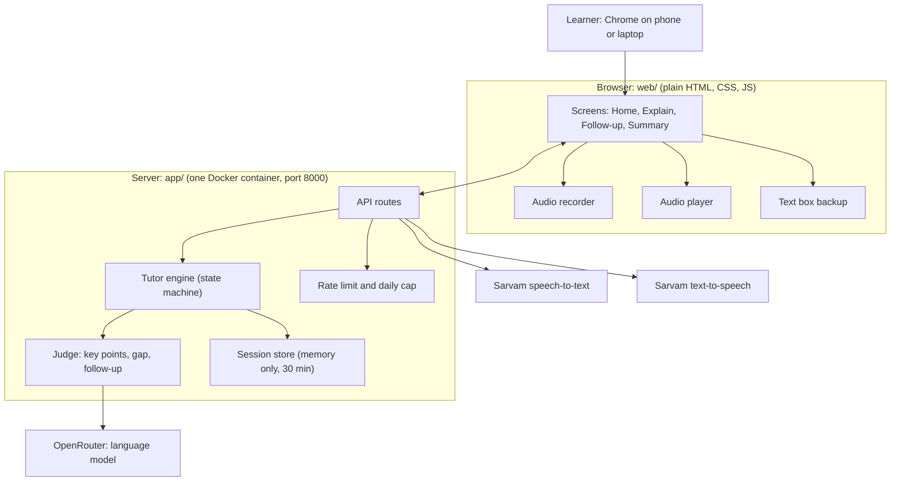
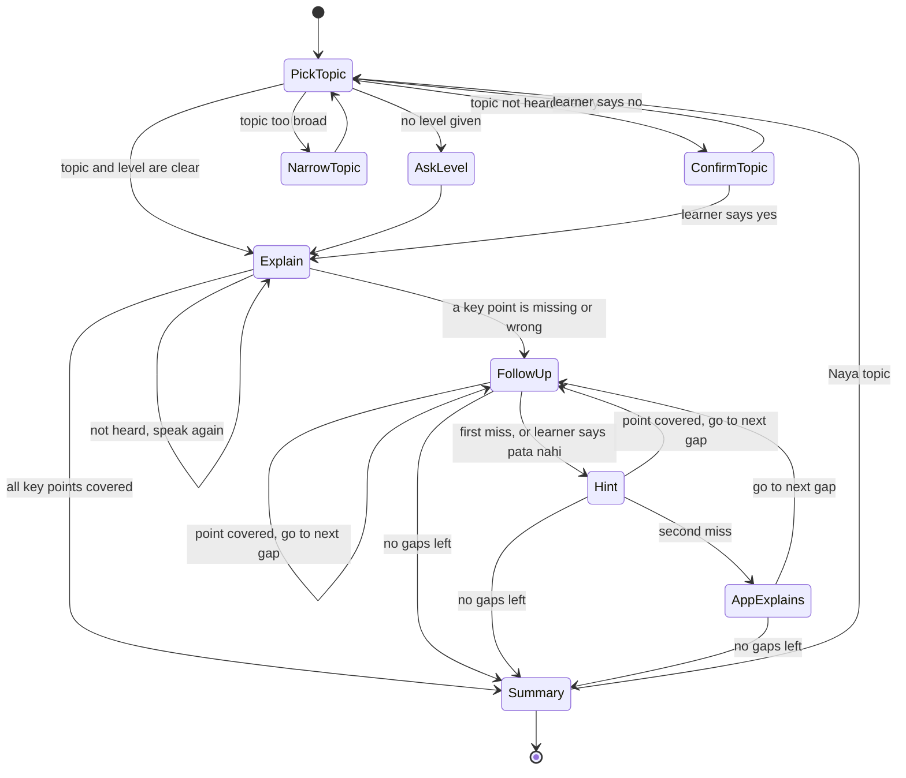

# Samjhao: handover for Claude Code

**Project:** Samjhao, a voice tutor that listens
**Owner:** Shubham Singh (solo entry, Builder #1621)
**Event:** Build for Bharat (India Runs on Voice), a Scaler × Wispr Flow hackathon, Round 2
**Written:** Fri 27 Nov 2026 (version 2: keys-only judging, OpenRouter, questions before technology)
**Hard deadline:** Mon 30 Nov 2026, 11:59 pm IST. One submission only. Everything must stay public and working until 2 Dec 2026.

Read this whole file before writing any code. Section 1 is plain English. The sections after it get steadily more technical.

**Two rules that override everything else in this file:**

1. **Ask Shubham before committing to any technology.** The technology in this file is a proposal, not a decision. Section 4 lists the questions to ask him first.
2. **Ask Shubham for a new OpenRouter key for this project.** Do not use any OpenRouter key you already have in memory, in your settings, or in another project, including the one used earlier for video generation.

---

## 1. The idea in plain English

### What Samjhao is

"Samjhao" is Hindi for "explain it to me".

Most learning apps talk and the student listens. Samjhao does the opposite. The student talks, and the app listens.

1. A learner says a topic, for example "Newton's third law, Class 11".
2. Samjhao says: "Explain this to me like I am your younger brother."
3. The learner explains it aloud for about a minute, in Hindi, English, or a mix of both.
4. Samjhao finds the exact place where the explanation breaks, or where a step was skipped.
5. It asks one short question about that place. It does not give the answer.
6. The learner tries again. If they are stuck, they get one small hint. If they are still stuck, Samjhao explains that one point in two sentences and moves on.
7. At the end, the learner sees which points they explained on their own and which ones needed help.

### The problem it solves

Students memorise answers without understanding them, and nobody notices until the exam. A written test shows only the final answer, not the thinking. The fastest way to check understanding is to ask someone to explain the idea in their own words. A teacher with a full classroom cannot do that for every student, and many parents cannot help with the subject or with the English.

### Who it is for

- **Main users:** Class 8 to 12 and college students in small towns and cities in India. They speak Hindi or another Indian language at home and study from English textbooks.
- **Also:** any adult who wants to check whether they really understand something.
- **Any subject, any concept.** This is a deliberate decision by Shubham. Do not narrow the product to school science.

### Why it must be voice

Explaining aloud is the task itself. Typing would defeat it: students type slowly, typing Hindi on a phone is hard, and typed answers get copied from the book. A spoken explanation shows the skipped steps and half-understood words. Learners also think in their home language and switch to English for technical words, and speaking lets them do that freely.

### What we are building this weekend

Not the full product. The Round 2 brief asks for **one core flow that works end to end**. Our one flow is:

> say a topic → explain it aloud → hear one follow-up question about the gap → answer → see the summary

### How keys fit in

Samjhao needs two paid services to work: one to turn speech into text and back (Sarvam), and one language model to judge the explanation (through OpenRouter). Both need secret keys. Shubham is happy to pay for these.

The hackathon reviewers start our code **without** any keys. The rule is that the app must still start and show its main screen, and a feature that needs a key may show a "key not set" message. So:

- **With keys (our live link, our video, our own testing):** everything works, for any topic.
- **Without keys (reviewers starting the code):** the app starts, shows the home screen, explains what Samjhao does, and says clearly that keys are not set. It points to the live link and the video.

There is **no rule-based "demo judge"**. Shubham decided against it. All judging is done by the language model.

Because the tutor does not work without keys, the **live link and the video are the only places a reviewer can see it working**. Treat the live link as a priority, even though the rules call it optional.

---

## 2. The rules we must meet (Round 2)

These come from the official Round 2 brief. Breaking any item in 2.1 means the build cannot move ahead.

### 2.1 Hard gates

| Rule | What it means for us |
|---|---|
| Public GitHub repo | Create a new public repo. All code is written between 27 and 30 Nov. |
| `docker-compose.yml` in the repo | `docker compose up` must start the app with one command. |
| Starts with **no secret keys** | The main screen must appear with no keys set, with a clear "key not set" message. Reviewers do not add keys. Nothing may crash. |
| About 300+ lines of our own code | Not a starter template with small changes. |
| One submission only | "Save draft" exists, but "Submit build" is final. |
| Links stay working until 2 Dec | Repo, video and live link must not change or break after submitting. |

### 2.2 What gets submitted

1. **Code on GitHub** (required)
2. **YouTube demo** (required): public or unlisted, 3 minutes or less, showing the product working
3. **Pitch deck PDF** (required): up to 10 MB. The reviewers read the **words**, not the pictures. It must cover: problem and solution; who it is for and how many; what it depends on and the risks; launch plan
4. **Live link** (optional in the rules, a priority for us): a small bonus if it works. We host it ourselves.

### 2.3 Form values

- This build is: **An extension of my Round 1 idea**
- Project name: **Samjhao**
- Theme: **Inclusive education**
- State: ask Shubham

### 2.4 What the rules say about tools

- Any editor or AI tool is allowed. The rules name ChatGPT, Claude and Cursor as examples.
- Nothing in the rules limits which paid services, models or speech tools the product uses.
- The deck must list the voice tools, AI models and services we depend on, and what happens if they get costly or stop.
- The only rule about keys is the no-keys start in 2.1.

### 2.5 What the reviewers value

No scoring rubric is published. The best signal is the brief's own four steps:

1. The problem is real and frequent, and voice makes it better.
2. People finish the main flow by speaking.
3. A working prototype for **one narrow use case**.
4. A few real users finish the task **unaided**.

Round 1 counts for 10% of the Round 2 score. Prizes go by total score.

---

## 3. Architecture

### 3.1 In plain words

There are three layers.

1. **The browser** is what the learner sees and talks to. It shows the screens, records the learner's voice, and plays the replies.
2. **Our server** holds the rules of the conversation: what to ask next, when to give a hint, when to move on. It also keeps the secret keys, so they never reach the browser. It is one small program in one Docker container.
3. **Outside services** do the heavy work: Sarvam turns speech into text and text into speech, and a language model (reached through OpenRouter) judges the explanation.

Without keys, layers 1 and 2 still start and show the home screen with a "keys not set" message.

### 3.2 Diagram (plain text, readable anywhere)

```
                 LEARNER  (Chrome on an Android phone or a laptop)
                                    |
                      speaks / listens / taps one mic button
                                    v
+--------------------------------------------------------------------------+
|  BROWSER      web/  (plain HTML + CSS + JS, mobile-first, no build step) |
|                                                                          |
|  Screens:    Home -> Explain -> Follow-up loop -> Summary                |
|  Speech in:  records audio, sends it to our server                       |
|  Speech out: plays the audio our server sends back                       |
|  Backup:     a text box, if the mic or the speech service fails          |
|  No keys:    home screen + "keys not set" message + links to the         |
|              live demo and the video                                     |
+--------------------------------------------------------------------------+
                                    |
                           HTTPS, JSON + audio
                                    v
+--------------------------------------------------------------------------+
|  SERVER       app/  (ONE Docker container, port 8000)                    |
|                                                                          |
|  /api/config       which keys are set (never returns a key)              |
|  /api/session/...  start, turn, summary                                  |
|  /api/transcribe   audio -> text                                         |
|  /api/speak        text -> audio                                         |
|                                                                          |
|   TUTOR ENGINE  (state machine: the rules of the talk; decides           |
|        |         hint / explain / move on / finish)                      |
|        v                                                                 |
|   JUDGE  (asks the language model: what are the key points,              |
|           which one is missing or wrong, what question to ask)           |
|                                                                          |
|   KEYS live here only.   SESSION STORE: memory only, 30 minutes.         |
|   RATE LIMIT + DAILY CAP, because the live link spends real money.       |
+--------------------------------------------------------------------------+
          |                         |                          |
          v                         v                          v
  Sarvam speech-to-text      OpenRouter -> language     Sarvam text-to-speech
  (SARVAM_API_KEY)           model for judging          (SARVAM_API_KEY)
                             (OPENROUTER_API_KEY)
```

### 3.3 Same diagram in Mermaid (renders on GitHub)



### 3.4 What works with which keys

| Keys set | What the learner gets |
|---|---|
| None | The app starts. Home screen, a short description of Samjhao, and a clear "keys not set" message with links to the live demo and the video. The mic button is visible but switched off. |
| OpenRouter only | Judging works. Speech is off, so the learner types in the text box. A message says the Sarvam key is missing. Useful while building. |
| Sarvam only | Speech works, but nothing can judge. A message says the OpenRouter key is missing. |
| Both | The full voice flow, for any topic. |

### 3.5 One turn, step by step

```
Learner taps mic and speaks
  -> browser records audio
  -> POST /api/transcribe  -> server -> Sarvam speech-to-text -> transcript
  -> browser shows the transcript with the "Galat suna? Phir se bolo" button
  -> POST /api/session/{id}/turn  {transcript}
       -> tutor engine -> judge -> OpenRouter -> language model
       <- which points are covered, the first gap, the follow-up question
  <- {action, text, progress}
  -> POST /api/speak {text} -> server -> Sarvam text-to-speech -> audio
  -> browser plays the audio and shows the same text in large type
```

Three services are called in a row on every turn, so speed matters. Show a "thinking" line while waiting. Aim for the reply to start within about 4 seconds of the learner finishing, and measure it.

### 3.6 The conversation as a state machine



---

## 4. Technology: ask first, then commit

**Do not install, sign up for, or build on any technology until Shubham has answered the questions in 4.2.** He has asked to be questioned properly before choices are locked. The table in 4.1 is a starting proposal with reasons, so that the questions have something concrete to react to.

### 4.1 Already decided by Shubham

| Part | Decision |
|---|---|
| Judging | A language model, with keys. **No rule-based or keyless judge.** |
| How we reach the language model | **OpenRouter**, with a **new personal key made for this project**. Not the key used for video generation, and not any key found in Claude Code's memory or other projects. |
| Which model judges | Open. Shubham's candidates are a GPT model and Claude Haiku. Choose by testing (section 10, milestone 0). |
| Speech-to-text | **Sarvam**. Chosen partly because it covers many Indian languages beyond Hindi and English. |
| Sarvam Dictate | **Not used.** Use Sarvam's regular speech-to-text. |
| Budget | He is willing to spend money on keys. Still ask before each new paid service, and set spending limits. |

### 4.2 Questions to ask Shubham before committing

How to ask:

- Ask in **small batches of three to five**, not all at once.
- Use **plain language**. For each question give your recommended answer and one line on why.
- Wait for his answer before building on that choice.
- Write each decision in `DECISIONS.md` in the repo, with the date and the reason.
- If a later finding changes a decision, tell him before switching.

**Batch 1: keys and judging (ask first)**

1. Please create a **new OpenRouter key for this project** and paste it into the `.env` file yourself (not into the chat). Can you also set a spending limit on that key, if OpenRouter offers one?
2. Which models should we compare for judging? You mentioned a GPT model and Claude Haiku. Should we add one stronger model as a benchmark, to see what the best possible judging looks like?
3. If two models disagree, what matters most to you: catching every mistake, replying fast, or low cost?
4. What is the most you are willing to spend in total over these four days, across all keys?

**Batch 2: speech**

5. Please create a **Sarvam key** and paste it into `.env` yourself. Is Sarvam fine for the spoken replies too, or only for listening?
6. What voice should Samjhao have? The idea says "friendly older sibling". Any preference between the voices Sarvam offers?
7. For the transcript, should English words stay in English letters and Hindi words in Hindi script (code-mixed), or should everything be written exactly as spoken (verbatim)? Recommendation: test both on a real Hinglish explanation and pick the one the judge reads best.

**Batch 3: languages and scope**

8. For this prototype, should we promise only Hindi and English, or let Sarvam detect any language it supports? Recommendation: build so that other languages are not blocked, but only claim languages that a real speaker has tested.
9. Which languages can you, or someone you know, test with a real speaker before Monday?
10. Any topic at any level is confirmed. Should there be any limits, for example topics the tutor should politely decline?
11. Should a session have a time limit or a maximum number of key points? Proposal: three to five key points.

**Batch 4: how it is built and hosted**

12. The proposal is a Python server with a plain HTML and JavaScript screen, in one Docker container, because it has the fewest parts that can fail when reviewers start it. Are you fine with that, or do you prefer something you already use?
13. Where should the live link be hosted? It needs a host that runs a Docker container with HTTPS. Do you already have a hosting account or a domain you want to use?
14. What should the no-keys screen say? Proposal: what Samjhao is, "keys are not set", and links to the live demo and the video.
15. GitHub: what is your username, and is the repo name `samjhao` fine?

**Batch 5: people and proof**

16. Who are the three to five learners you can test with on Sunday, and what phones do they use?
17. Who can do the fresh-download test on Monday?
18. Which state should go on the submission form?
19. Confirm that nothing is stored after a session and no transcripts are logged.

### 4.3 Starting proposal (not final)

| Part | Proposal | Why |
|---|---|---|
| Server | Python 3.12 + FastAPI + Uvicorn | Small, quick to write, easy to test |
| Screen | Plain HTML, CSS and JavaScript, served by the same server | No build step, so nothing extra can break under Docker |
| Containers | One service in `docker-compose.yml` | One command, one port (8000) |
| Storage | In memory, 30-minute expiry | The product promises "no login, nothing stored" |
| Speech in | Sarvam speech-to-text; the browser records audio and the server forwards it | Keeps the key on the server |
| Speech out | Sarvam text-to-speech, played in the browser | One speech provider, one key |
| Judging | OpenRouter's chat API, with the model name as a setting | Models can be swapped by changing one setting |
| Backup input | A text box | If the mic or speech service fails, the learner is not stuck |

### 4.4 Facts to check against live documentation before relying on them

Some of these were read on 23 Nov 2026 from Sarvam's site. Others are from general knowledge. None has been tested for this project.

- Sarvam's REST transcription endpoint was described as being for quick responses **under 30 seconds** of audio. Our explanation turn is up to 90 seconds. If the limit holds, split the recording into chunks of about 25 seconds, or use Sarvam's streaming API.
- Sarvam's speech-to-text has several output modes, including a **code-mixed** mode and a **verbatim** mode.
- Sarvam's docs advertise an MCP server for AI coding tools at `https://docs.sarvam.ai/_mcp/server`. Connecting it may be the fastest way to get correct API details.
- OpenRouter offers an OpenAI-compatible chat API. Check the current base URL, the exact model names for the candidates, the prices, and whether a spending limit can be set per key.
- Microphone access in the browser needs a secure page. `http://localhost` counts as secure, and the live link must be HTTPS. Verify on a real Android phone.
- Check which audio formats the phone's recorder produces and which formats Sarvam accepts. Convert on the server if they differ.

---

## 5. Repository layout (proposal)

```
samjhao/
├── docker-compose.yml
├── Dockerfile
├── requirements.txt
├── .env.example            # every setting, all blank, with comments
├── .gitignore              # must include .env
├── README.md               # what it is, how to run, how to add keys, known limits
├── HANDOVER.md             # this file
├── DECISIONS.md            # Shubham's answers to the questions in section 4.2
├── app/
│   ├── main.py             # app, routes, serves web/
│   ├── config.py           # reads settings, works out which keys are set
│   ├── sessions.py         # in-memory store with expiry
│   ├── ratelimit.py        # per-IP limit and daily cap
│   ├── tutor/
│   │   ├── engine.py       # the state machine
│   │   ├── models.py       # data shapes
│   │   ├── judge.py        # calls the language model
│   │   ├── prompts.py      # the prompt texts
│   │   ├── strings.py      # every fixed phrase, Hindi and English
│   │   └── language.py     # works out the learner's main language
│   └── providers/
│       ├── llm_openrouter.py
│       ├── stt_sarvam.py
│       └── tts_sarvam.py
├── web/
│   ├── index.html
│   ├── styles.css
│   ├── app.js              # screens and flow
│   ├── audio.js            # recorder and player
│   └── api.js              # calls to the server
├── scripts/
│   └── try_prompts.py      # runs sample explanations through the judge
├── tests/
│   ├── test_engine.py      # uses a fake judge, so it runs with no keys
│   ├── test_keyless_start.py
│   └── fixtures/reference_topics.json
└── docs/
    ├── pitch-deck.md       # deck text; exported to PDF
    ├── demo-script.md      # the 3-minute video script
    └── user-tests.md       # notes from real users
```

### 5.1 docker-compose.yml requirements

- One service, built from the local `Dockerfile`, mapping port `8000:8000`.
- Pass settings with empty defaults, for example `OPENROUTER_API_KEY: ${OPENROUTER_API_KEY:-}`. Do **not** use a required `env_file`, because a fresh download has no `.env` and the start would fail.
- Add a health check on `/healthz`.
- `docker compose up` on a fresh download, with no `.env`, must reach the home screen at `http://localhost:8000`.

### 5.2 Settings (`.env.example`)

| Setting | Purpose | Default |
|---|---|---|
| `OPENROUTER_API_KEY` | Turns on judging. **A new key made for this project.** | blank |
| `LLM_MODEL` | Model name, taken from OpenRouter's current list | blank |
| `LLM_BASE_URL` | OpenRouter's chat endpoint, from its current docs | blank |
| `SARVAM_API_KEY` | Turns on speech in and out | blank |
| `SARVAM_STT_MODEL` | Speech-to-text model name from Sarvam's docs | blank |
| `SARVAM_STT_MODE` | `codemix` or `verbatim` | decide by testing |
| `SARVAM_TTS_VOICE` | The voice Shubham picks | blank |
| `LIVE_DEMO_URL` | Shown on the no-keys screen | blank |
| `VIDEO_URL` | Shown on the no-keys screen | blank |
| `SESSION_TTL_MINUTES` | How long a session lives | `30` |
| `RATE_LIMIT_PER_MINUTE` | Per-IP request limit | `30` |
| `DAILY_REQUEST_CAP` | Stops the public link from running up a bill | `2000` |

### 5.3 Key handling

- **Ask Shubham for a new OpenRouter key for this project.** Never read one from Claude Code's memory, from your own settings, from the environment of another project, or from any earlier work such as the video generation project.
- Create `.env` from `.env.example` and ask Shubham to paste each key into the file himself. Keys should not be pasted into the chat.
- `.env` is in `.gitignore` from the very first commit. Check the commit history for keys before the repo is made public.
- Keys live only on the server. They are never sent to the browser and never logged.
- On the live link, keep the rate limit and the daily cap on, and ask Shubham to set a spending limit on each key where the provider allows it.

---

## 6. Product behaviour (the spec)

### 6.1 Screens

One screen at a time, one large mic button, no menus, no login.

1. **Home.** The app says and shows the opening line. The learner says any topic and their level. Three example chips are shown for learners who are unsure: "Newton's third law, Class 11", "Compound interest", "Why the moon has phases".
   - If keys are missing, this screen still appears, with the message from 3.4 and the mic switched off.
2. **Explain.** The app says the "younger brother" line. The learner taps the mic and speaks for up to 90 seconds. Recording stops on a second tap or after 4 seconds of silence. The transcript appears when it is ready.
3. **Follow-up loop.** The app's question is shown in large text and spoken. Under the learner's last transcript is the re-record button. A small progress row shows how many key points are done, without revealing them.
4. **Summary.** Lists the key points. Green tick: explained without a hint. Amber dot: needed a hint, or the app explained it. One button: "Naya topic".

Design rules: large text, a mic button at least 96 px wide, strong contrast, works at 360 px width, everything shown is also spoken.

### 6.2 Rules of the conversation

1. Before the learner explains, fix a hidden list of **three to five key points** for the topic at their level. The list does not change during the session.
2. Compare what the learner said with the key points **by meaning, not exact words**.
3. Find the **first** key point that is missing or wrong.
4. Ask **one** follow-up question about that point only, under 20 words, without giving the answer.
5. If the answer covers the point, say the "correct" line and go to the next gap.
6. If it does not, give one short hint and ask again.
7. If the second try also misses, explain the point in two sentences and move on.
8. When no gaps are left, say the "done" line and show the summary.

Counting rules, to avoid loops:

- Each key point allows **two real tries** and **one hint**.
- "Pata nahi", or 10 seconds of silence after a question, gives the hint straight away and does **not** use up a try.
- If the learner says "pata nahi" again after the hint, explain the point and move on.
- Summary colour: green if covered in the first explanation or after a follow-up question with no hint. Amber if a hint was given or the app explained it.
- Never count the app's own hint or explanation as the learner's knowledge.

### 6.3 Tone

A friendly older sibling. Never say "wrong" or "galat" about the learner's answer. Say "Yahan thoda aur batao." Never correct pronunciation.

### 6.4 Language rules

- Accept Hindi, English, and both mixed inside one sentence. Never ask the learner to choose a language.
- Reply in the language the learner used most in their last answer.
- Keep technical terms in English, as textbooks do.
- On screen, Hindi is in Devanagari and English words are in Latin letters.
- Whether the prototype goes beyond Hindi and English is an open question for Shubham (section 4.2, question 8). Build so that other languages are not blocked.

### 6.5 Fixed phrases (`strings.py`)

| Key | Hindi (shown and spoken) | English |
|---|---|---|
| `home_open` | आज क्या समझाओगे? Topic बोलो, और अपनी class बताओ। | What will you explain today? Say the topic and your class. |
| `ask_level` | कौन सी class में हो? | Which class are you in? |
| `narrow_topic` | {subject} में कौन सा topic? | Which topic in {subject}? |
| `confirm_topic` | तुमने {topic} कहा? | Did you say {topic}? |
| `start_explain` | मुझे यह ऐसे समझाओ जैसे मैं तुम्हारा छोटा भाई हूँ। Mic दबाओ और बोलो। | Explain this to me like I am your younger brother. Tap the mic and speak. |
| `correct` | हाँ, बिल्कुल सही। | Yes, exactly right. |
| `say_more` | यहाँ थोड़ा और बताओ। | Tell me a little more here. |
| `hint_prefix` | एक छोटा hint: | A small hint: |
| `done` | शाबाश, तुमने पूरा समझा दिया। | Well done, you explained all of it. |
| `not_heard` | आवाज़ साफ़ नहीं आई। Phone पास लाकर फिर से बोलो। | I could not hear clearly. Bring the phone closer and say it again. |
| `rerecord_button` | गलत सुना? फिर से बोलो | Heard it wrong? Say it again |
| `confirm_word` | तुमने {a} कहा या {b}? | Did you say {a} or {b}? |
| `off_topic` | चलो वापस topic पर आते हैं। | Let us come back to the topic. |
| `unsure_topic` | इस topic पर मुझे पूरा भरोसा नहीं है। क्या हम {nearby} पर बात करें? | I am not fully sure about this topic. Shall we talk about {nearby}? |
| `thinking` | सोच रहा हूँ… | Thinking… |
| `new_topic_button` | नया topic | New topic |
| `keys_missing` | Keys set नहीं हैं, इसलिए Samjhao अभी सुन या जवाब नहीं दे सकता। | Keys are not set, so Samjhao cannot listen or reply yet. Try the live demo or watch the video. |
| `service_down` | अभी थोड़ी दिक्कत आ रही है। थोड़ी देर में फिर से कोशिश करो। | Something is not working right now. Please try again in a little while. |

### 6.6 When things go wrong

| Situation | What the app does |
|---|---|
| Keys are not set | Home screen with `keys_missing` and the two links. No crash, no raw error. |
| Nothing heard, or the first explanation is under five words | Say `not_heard`. Keep earlier progress. After two failed tries in a row, show the text box. |
| A follow-up answer is short | That is fine. Short answers such as "sooraj se" are valid. The five-word rule applies **only** to the first explanation. Only an empty transcript counts as not heard. |
| Topic not heard clearly | Say `confirm_topic` and start only after a yes. |
| Topic too broad, such as "physics" | Say `narrow_topic`. |
| Accent or unusual pronunciation | Accept any pronunciation or spelling of a technical term, and its Hindi name: "photosynthesis", "fotosintesis", "prakash sanshleshan". |
| A key point depends on a word that may have been misheard | Say `confirm_word` before judging. |
| The transcript is wrong | The `rerecord_button` under every transcript re-records only the last answer. |
| "Pata nahi", or 10 seconds of silence after a question | Give the hint straight away. Do not use up a try. |
| Off-topic talk | Say `off_topic` and repeat the last question. |
| The judge is not confident about a topic | Say `unsure_topic`. Do not guess the key points. |
| Mic permission refused, or no mic | Show the text box with a short note on how to allow the mic. |
| Sarvam or OpenRouter fails or is slow | Retry once. Then say `service_down` in plain words. Never show a raw error. If only speech failed, offer the text box. |
| The daily cap is reached on the live link | Say plainly that today's demo limit is used up, and show the video link. |

---

## 7. Server interface (proposal)

All replies are JSON unless noted. No endpoint ever returns a key.

| Method and path | Sends | Returns |
|---|---|---|
| `GET /` | | the web app |
| `GET /healthz` | | `{"ok": true}` |
| `GET /api/config` | | `{"judging": true or false, "speech": true or false, "live_demo_url": "", "video_url": ""}` |
| `POST /api/session/start` | `{topic_text, level?}` | `{session_id, action, text, lang, points_total}` |
| `POST /api/session/{id}/turn` | `{transcript, heard_ok}` | `{action, text, lang, progress, summary?}` |
| `GET /api/session/{id}/summary` | | `{points: [{statement, result}]}` |
| `POST /api/transcribe` | audio file | `{transcript}` |
| `POST /api/speak` | `{text, lang}` | audio |

When a needed key is missing, the endpoint returns a clean `{"error": "keys_not_set", "missing": [...]}` reply, never a crash.

`action` is one of:

`ask_level`, `narrow_topic`, `confirm_topic`, `unsure_topic`, `start_explain`, `retry_audio`, `show_text_box`, `confirm_word`, `follow_up`, `hint`, `app_explains`, `off_topic`, `done`

`progress` is `{done: 2, total: 4}`. The key point texts are sent to the browser only in the summary.

---

## 8. Reference topics (for testing the judge, not for a rule-based checker)

These five topics are an answer key. Use them to check that the language model writes sensible key points and judges correctly. They are **not** used to judge learners at run time.

Shubham should read them once, because they were drafted quickly.

### Topic 1: Why the moon has phases (Class 8)

1. The moon has no light of its own. It shines by reflecting sunlight.
2. The half of the moon facing the sun is always lit.
3. The moon goes around the Earth, about once a month.
4. As it moves, we see different amounts of the lit half from Earth. That changing view is the phases.

Known mistake: "the Earth's shadow falls on the moon". That is an eclipse, not a phase.

### Topic 2: Why we see lightning before we hear thunder (Class 8)

1. Lightning and thunder are made at the same moment. Thunder is the sound of the lightning.
2. Light travels extremely fast, so we see the flash almost at once.
3. Sound travels far slower through air.
4. So the sound arrives later. The farther away the lightning, the longer the gap.

Known mistake: "lightning happens first and thunder happens after it".

### Topic 3: How plants make food (Class 8)

1. Plants make their own food in their leaves, which contain green chlorophyll.
2. They use sunlight as the energy for it.
3. They take in water through the roots and carbon dioxide from the air.
4. They make glucose (sugar) as food and give out oxygen.

Known mistake: swapping the gases ("plants take in oxygen and give out carbon dioxide").

### Topic 4: Why ice floats on water (Class 9)

1. A thing floats on a liquid when it is less dense than the liquid.
2. When water freezes, it expands and takes up more space.
3. So ice has the same mass in a bigger volume, which makes it less dense than water.
4. That is why ice floats. Water is unusual here: most substances get denser when they freeze.

Known mistake: "ice floats because it is lighter" with no mention of density or volume.

### Topic 5: Why we have day and night (Class 8)

1. Only the half of the Earth that faces the sun is lit at any time.
2. The Earth spins on its own axis.
3. One full spin takes about 24 hours.
4. As the Earth spins, a place moves into the sunlight (day) and then out of it (night).

Known mistake: "the sun goes around the Earth".

---

## 9. The judge: language model prompts

Two calls, both through OpenRouter. Both must return JSON only. Validate the JSON and retry once if it is malformed.

### 9.1 Call A: make the key points (once per session)

**Input:** topic text, level, learner's language.

**Instruction (draft):**

> You are preparing a hidden checklist for a tutor that listens to a learner explain a concept aloud. Topic: {topic}. Level: {level}.
> Decide the status first:
> - "too_broad" if this is a whole subject or chapter, not one concept. Give `narrow_subject`.
> - "not_a_concept" if there is nothing to explain.
> - "unsure" if you are not confident you can list the key points correctly at this level. Give one `nearby_topic` you are confident about.
> - "ok" otherwise.
> If "ok", write 3 to 5 key points that a correct explanation at this level must include, in the order a good explanation would say them. Each must be checkable from speech. No trivia, no extra facts beyond the level.
> For each key point give: `statement` (one sentence, English); `common_mistake` (the usual wrong idea, or empty); `hint` (one short sentence in the learner's language that points toward the idea without stating it); `explanation` (two short sentences in the learner's language).
> Write Hindi in Devanagari and keep technical terms in English.

**Output shape:**

```json
{
  "status": "ok",
  "topic_clean": "Newton's third law of motion",
  "narrow_subject": "",
  "nearby_topic": "",
  "key_points": [
    {"id": 1, "statement": "", "common_mistake": "", "hint": "", "explanation": ""}
  ]
}
```

### 9.2 Call B: judge a turn and write the follow-up (once per learner turn)

**Input:** topic, level, the key points with their current status, the conversation so far, the latest transcript, and which point was being asked about (or none, for the first explanation).

**Instruction (draft):**

> You are judging what a learner just said while explaining {topic} at {level} level.
> For each key point, decide: "covered", "missing" or "wrong".
> Rules:
> - Judge by meaning, not wording. Accept any pronunciation, spelling or transliteration of a term, and its Hindi name.
> - Be lenient about grammar and fluency. Be strict about facts: a wrong statement must be marked "wrong", never "covered".
> - Mark "covered" only if you can quote the learner's words as evidence.
> - Do not count anything the tutor said (hints, explanations) as the learner's knowledge.
> - A point already covered earlier stays covered unless the learner now contradicts it.
> Then find the first key point that is missing or wrong. Write ONE follow-up question about that point only: under 20 words, does not reveal the answer, in the language the learner used most in their latest turn. Hindi in Devanagari, technical terms in English. Warm tone. Never use the words "wrong" or "galat".
> Also report: whether the learner said they do not know; whether they went off topic; and whether your judgement of a point depends on one word that may have been misheard (give the word heard and the likely alternative).

**Output shape:**

```json
{
  "points": [{"id": 1, "status": "covered", "evidence": ""}],
  "first_gap_id": 2,
  "dont_know": false,
  "off_topic": false,
  "reply_lang": "hinglish",
  "unclear_word": null,
  "follow_up": ""
}
```

The engine, not the model, decides what happens next (hint, explain, move on, finish). The model only judges and writes the question. Hints and explanations come from Call A, so they are ready instantly.

### 9.3 Sample explanations for testing the judge

Each has a known flaw. A good judge must catch it and must **not** approve it.

| # | Topic | What the learner says | What must be caught |
|---|---|---|---|
| 1 | Moon phases, Class 8 | "Chand ke phases isliye hote hain kyunki Earth ki shadow chand par padti hai, toh kabhi aadha dikhta hai kabhi poora." | Shadow idea is wrong. Reflection and orbit are missing. |
| 2 | Lightning and thunder, Class 8 | "Bijli pehle dikhti hai kyunki light bahut fast hoti hai." | Nothing about sound being slower, or both starting together. |
| 3 | Photosynthesis, Class 8 | "Plants sunlight se khana banate hain, leaves mein chlorophyll hota hai, aur woh oxygen lete hain aur carbon dioxide chhodte hain." | Gases are swapped. Water is missing. |
| 4 | Newton's third law, Class 11 | "Har action ka equal aur opposite reaction hota hai, isliye dono cancel ho jaate hain aur cheez move nahi karti." | The two forces act on different bodies, so they do not cancel. |
| 5 | Compound interest | "Compound interest mein har saal same interest milta hai principal par, bas rate zyada hota hai." | Interest is earned on earlier interest too. |

### 9.4 Choosing the judging model

Run the five samples, plus one fully correct explanation, through each candidate model. For each model, record:

- Did it catch every known flaw?
- Did it approve the fully correct explanation without inventing a gap?
- Is the follow-up question about the right point, short, and free of the answer?
- How long did it take, and what did it cost per turn?

Show Shubham the results side by side in plain language and let him pick. A model that approves a wrong explanation is ruled out, however fast or cheap it is.

---

## 10. Build order

Work in this order. After every milestone, run `docker compose up` with **no keys set** and confirm the home screen loads. Commit small and often, with clear messages, so the history shows the work was done during the hackathon.

| # | Milestone | Done when |
|---|---|---|
| A | **Questions.** Ask batch 1 from section 4.2, then the other batches as each part comes up. | Answers are written in `DECISIONS.md`. |
| 0 | **Prove the judge is good.** Write `scripts/try_prompts.py` and run section 9.4 across the candidate models. | Shubham has seen the comparison and picked a model. If the questions are weak, fix the prompts before building further. |
| 1 | **Skeleton that starts with no keys.** Repo, Dockerfile, compose file, `/healthz`, `/api/config`, a home screen with the `keys_missing` message. This can be built while waiting for keys. | Fresh download + `docker compose up` shows the home screen. |
| 2 | **Tutor engine + tests.** Tests use a fake judge, so they run with no keys. | Tests cover: all points covered first time; one miss then covered; hint then covered; two misses then app explains; "pata nahi"; summary colours; keys missing. |
| 3 | **Judging end to end with typed input.** The judge, any topic, ask level, narrow topic, confirm topic, unsure topic. | A full session works in the browser using the text box and the OpenRouter key. |
| 4 | **Voice in and out.** Recorder, `/api/transcribe`, `/api/speak`, the re-record button, the not-heard retry. | A full session works **by speaking**, on a phone, in Hinglish. **This is the minimum that can be submitted.** |
| 5 | **Live link.** Deploy the same container to a host with HTTPS. Rate limit and daily cap on. | The link works on an Android phone on mobile data. |
| 6 | **Remaining failure cases.** Silence timer, off-topic, word confirmation, service failures, mic refused. | Each row in 6.6 has been tried by hand. |
| 7 | **Real users.** Three to five people try it without help. Notes go in `docs/user-tests.md`. | Fixes for anything that stopped a user. |
| 8 | **Submission pieces.** README, deck PDF, 3-minute video, fresh-download test by a friend, links set on the no-keys screen. | Everything in section 12 is ticked. |

### 10.1 Suggested timing

- **Fri 27 Nov:** A, 0, 1 and 2.
- **Sat 28 Nov:** 3 and 4. Start 5.
- **Sun 29 Nov:** 5, 6 and 7. First draft of the deck.
- **Mon 30 Nov:** 8. Aim to submit by 9 pm, not 11:59 pm, because there is only one submission.

If time runs short, cut milestone 6 first. Never cut 1, 4, 5 or 8.

---

## 11. The other deliverables

### 11.1 Pitch deck (PDF, real text, up to 10 MB)

Write it in `docs/pitch-deck.md` first, then export to PDF. The reviewers read the words, so every key point must be selectable text, not text inside an image. Deliver the final file to Shubham as a PDF.

1. **Problem and solution.** Use section 1. Lead with "it listens instead of asking questions", because the hackathon's own education example is spoken quizzes and many entries will look like quiz bots.
2. **Who it is for, and how many.** About 8.5 crore students in Classes 8 to 12. UDISE+ 2024-25: 3.72 crore in Classes 9 and 10, and 2.76 crore in Classes 11 and 12. The Class 8 share of about 2 crore is an **estimate**: one third of the 6.37 crore in Classes 6 to 8. Say it is an estimate. No verified number is available here for college students or adults, so do not invent one.
3. **What it depends on, and the risks.** Sarvam for speech in and out, OpenRouter and the chosen language model for judging. For each, say what happens if it gets costly or stops:
   - Judging: OpenRouter lets us change the model with one setting, so a costly or withdrawn model can be replaced quickly. Give the measured cost per session from real runs, not a guess.
   - Speech: the speech provider sits behind one small part of the code, so it can be swapped. The text box keeps the app usable if speech is down.
   - The main product risk, stated honestly: the tutor can judge wrongly. It may mishear a learner, or approve a wrong explanation. Mitigations: testing the judge against known-wrong explanations, teacher-checked key points for common topics, saying plainly when unsure, always showing what was heard.
4. **Launch plan.** Start with school students in Hindi-speaking states. Reach first users through teachers and tuition centres who share a link on WhatsApp. First-year goal: 1 lakh regular users. Proposed targets (Shubham's, not benchmarks): 60% of hinted topics explained without a hint a week later; 40% still using it three evenings a week in week four; a 200-student pilot across four schools.

Sources for the figures:
- https://educationforallinindia.com/school-education-in-india-an-analysis-based-on-udise-2021-22-to-2024-25/
- https://educationforallinindia.com/secondary-education-in-india-where-do-we-%20stand-an-analysis-of-udise-2024-25-data/

### 11.2 Demo video (YouTube, 3:00 or less)

Draft the script in `docs/demo-script.md`. Suggested shape:

- 0:00–0:20: the problem, in one breath. A student who can recite the answer but cannot explain it.
- 0:20–2:10: one real, uncut session on a phone. A learner explains a topic in Hinglish with a real mistake. Samjhao asks about that exact point. The learner fixes it. Summary screen.
- 2:10–2:40: one failure case handled well (noise and the re-record button), and a topic outside school science to show "any concept".
- 2:40–3:00: who it is for, and what was built in four days.

Show the product working. Do not fill the video with slides. Since reviewers cannot run the tutor without keys, this video carries a lot of the proof.

### 11.3 README

What Samjhao is; how to run it (`docker compose up`, then open `http://localhost:8000` in Chrome); what appears with no keys; how to add keys; the live demo and video links; known limits; what was built during the hackathon.

---

## 12. Pre-submission checklist

**Code**
- [ ] Public GitHub repo
- [ ] `docker compose up` on a fresh download, with no `.env`, shows the home screen
- [ ] With no keys, the screen says clearly that keys are not set, and links to the live demo and the video
- [ ] No keys anywhere in the repo or its history
- [ ] Well over 300 lines of our own code
- [ ] A friend has downloaded and started it on their own machine

**Product**
- [ ] The core flow works end to end by speaking, with keys
- [ ] Three to five real users finished without help; notes saved

**Live link**
- [ ] HTTPS, works on a phone, rate limit and daily cap on, spending limits set, stays up until 2 Dec

**Video**
- [ ] YouTube, public or unlisted, 3:00 or less, product shown working

**Deck**
- [ ] PDF, under 10 MB, key points as real text, all four parts covered

**Form**
- [ ] Extension of Round 1 idea · Samjhao · Inclusive education · State
- [ ] Four checkboxes ticked
- [ ] Submitted well before 30 Nov, 11:59 pm IST
- [ ] Nothing changed or taken down before 2 Dec
- [ ] Email watched after submitting, in case a check fails and the build comes back

---

## 13. How to work with Shubham

- **Ask before committing to any technology.** Use the questions in section 4.2, in small batches, with your recommendation and the reason.
- **Explain in plain, simple language first, then build up to the technical detail.** He leads a mentoring and customer-success team. Do not assume he reads code fluently.
- He will often **dictate** his messages using Wispr Flow, so they may read like speech and a word may be misheard. If a sentence does not make sense, ask what he meant instead of guessing.
- **Ask before** signing up for or choosing any paid service, and before anything that costs money.
- Do not hand him checks you can run yourself. Run the test, settle it, and report the result.
- When something cannot be done or is uncertain, say so plainly and give the next step.
- Never deliver documents to him as HTML files. Use PDF.
- He works solo on this, around a full-time job. Keep his own tasks short and clearly listed.

### 13.1 Guardrails

- Never use an OpenRouter key from memory, settings or another project. Ask for a new one.
- Never commit a key. `.env` is in `.gitignore` from the first commit.
- After every milestone, test the no-keys start again.
- Do not build a rule-based or keyless judge.
- Do not use Sarvam Dictate.
- Do not add a login, a database or analytics.
- Do not narrow the product to school science.
- Store nothing after a session ends. Do not log transcripts. Some users will be children.
- Do not change the repo, video or live link between submitting and 2 Dec.

---

## 14. Tasks only Shubham can do

1. Create a **new OpenRouter key** for this project and paste it into `.env`.
2. Create a **Sarvam key** and paste it into `.env`.
3. Answer the questions in section 4.2.
4. Pick the judging model after seeing the comparison.
5. Create the public GitHub repo, or approve creating it.
6. Choose the hosting for the live link.
7. Read the 20 reference key points in section 8 and correct anything wrong.
8. Find three to five learners for Sunday.
9. Find a friend to do the fresh-download test on Monday.
10. Record the demo video and upload it to YouTube.
11. Wispr Flow verification: the dashboard showed "Not detected yet". This is not needed for Round 2, but it affects Round 1 prize eligibility. Use the "Update Wispr email" option if the Wispr sign-up used a different email.

The starter prompt for Claude Code is in a separate file, `STARTER_PROMPT.md`.
